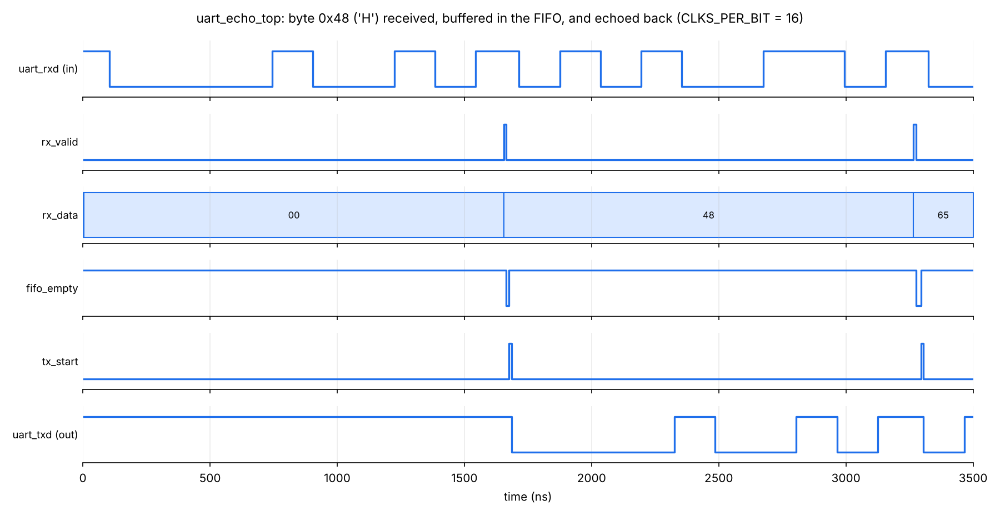
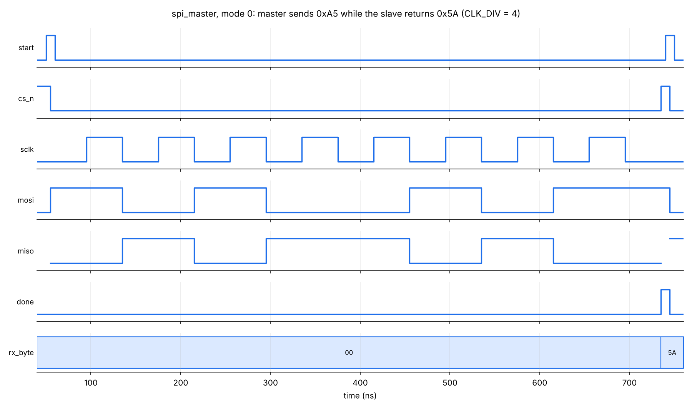

# Digital Design RTL


Synthesizable Verilog building blocks — serial interfaces, a FIFO, a debouncer and an FSM — each with a **self-checking testbench**. Every module is lint-clean under Verilator `-Wall`, and CI re-runs all simulations on every push.

| Module | What it is | What the testbench checks |
|---|---|---|
| [`debouncer`](rtl/debouncer.v) | 2-flop synchronizer + stable-time counter for push buttons | Random bounce patterns never leak through; exactly one `rise` pulse per press; short glitches rejected |
| [`sync_fifo`](rtl/sync_fifo.v) | Parameterized single-clock FIFO, first-word fall-through, extra-MSB pointers | 5,000 random cycles against a scoreboard model; `full`/`empty`/`count`/data checked every cycle; coverage check that full and empty are both reached |
| [`uart_tx`](rtl/uart_tx.v) / [`uart_rx`](rtl/uart_rx.v) | 8N1 UART, configurable baud; RX samples mid-bit, rejects false starts, flags framing errors | 206-byte loopback incl. `00/FF/55/AA`; exact bit timing on the line; bad stop bit → `frame_err`; glitch → ignored |
| [`spi_master`](rtl/spi_master.v) | SPI mode 0 (CPOL=0, CPHA=0), MSB first, configurable SCLK divider | Full-duplex against a behavioral slave model, 204 transfers; both directions; exactly 8 SCLK edges; SCLK idles low while CS is high |
| [`traffic_light`](rtl/traffic_light.v) | Two-road intersection Moore FSM with pedestrian walk phase | Assertion-style checks over 20,000 cycles: roads never both open, walk only on all-red, green→yellow→red order, exact phase durations, every walk request served |
| [`uart_echo_top`](rtl/uart_echo_top.v) | Integration: UART RX → FIFO → UART TX, with sticky overflow flag | Sends a string back-to-back from a host-side UART model and checks the echo byte for byte |

## Waveforms

**UART echo** — the byte `0x48` (`'H'`) arrives on `uart_rxd`, is written to the FIFO when `rx_valid` pulses, and is re-transmitted on `uart_txd`:



**SPI mode 0** — MOSI changes on falling SCLK edges, MISO is sampled on rising edges; the master sends `0xA5` and receives `0x5A`:



## Running it

Requires [Icarus Verilog](https://steveicarus.github.io/iverilog/) (`apt install iverilog` / `brew install icarus-verilog`). GTKWave and Verilator are optional.

```bash
make                    # run all six testbenches
make uart               # run one (debouncer, sync_fifo, uart, spi_master, traffic_light, uart_echo_top)
make wave-uart          # open its waveform (build/tb_uart.vcd) in GTKWave
make lint               # Verilator -Wall lint on all RTL
```

Expected output:

```
=== uart ===
tb_uart: 206 bytes looped back, 0 errors
TEST PASSED
...
All 6 testbenches passed.
```

Regenerate the waveform images with `scripts/plot_wave.py` (needs `pip install vcdvcd matplotlib`).

## Design notes

- **Metastability.** Every asynchronous input (`btn_in`, `rx`) goes through a two-flop synchronizer before any logic looks at it.
- **UART sampling.** The receiver waits half a bit after the falling edge, re-checks the line (rejecting glitches), then samples each bit in its center — the point of maximum margin against baud mismatch.
- **FIFO full vs. empty.** Read and write pointers are one bit wider than the address. Equal pointers mean empty; equal addresses with different MSBs mean full — no extra counter needed.
- **Clean handshakes.** In `uart_echo_top`, `tx_start` is registered so the transmitter's `busy` is already high before the controller can issue a second start — no double-sends.
- **Coding style.** `default_nettype none`, active-low async reset, one FSM per `always` block, width-exact constants (Verilator `-Wall` clean).
- **Do the tests actually test?** Each testbench was checked by injecting a bug into the RTL (reversed UART bit order, broken FIFO empty flag, skipped yellow light, SPI sampling the wrong pin) and confirming the test fails.

## Layout

```
rtl/        synthesizable Verilog
tb/         self-checking testbenches (print TEST PASSED / TEST FAILED)
scripts/    VCD → PNG waveform renderer
docs/       waveform images
.github/    CI: runs lint + every testbench on each push
```

## Next steps

- [ ] Run `uart_echo_top` on an FPGA (iCEBreaker / Basys 3) and talk to it from a serial terminal
- [ ] I2C master (the hardware side of my I2C firmware work)
- [ ] cocotb (Python) versions of the testbenches with functional coverage
- [ ] Synthesize with Yosys and report LUT / flip-flop usage per module
